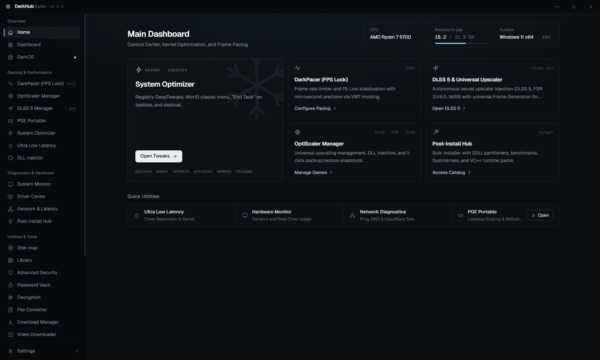

<p align="center">
  
</p>

<h1 align="center">DarkHub Suite</h1>

<p align="center">
  Utilitário para Windows focado em desempenho em jogos, latência, monitoramento de hardware, reparo do sistema,
  segurança e ferramentas offline.<br/>
  Toda alteração que ele faz no Windows tem snapshot, é verificada e pode ser desfeita.
</p>

<p align="center">
  <a href="https://github.com/Pokeralho/darkhub-suite/releases/latest"></a>
  <a href="https://github.com/Pokeralho/darkhub-suite/releases"></a>
  <a href="https://github.com/Pokeralho/darkhub-suite/actions/workflows/ci.yml"></a>
  <a href="./LICENSE"></a>
  
</p>

<p align="center">
  <a href="./README.md">English</a> · <b>Português</b>
</p>

<p align="center">
  <a href="#instalação">Instalação</a> ·
  <a href="#funcionalidades">Funcionalidades</a> ·
  <a href="#como-ele-se-mantém-seguro">Segurança</a> ·
  <a href="#por-que-o-darkhub-precisa-de-administrador-e-o-que-fazem-as-partes-sensíveis">Administrador</a> ·
  <a href="#arquitetura">Arquitetura</a> ·
  <a href="#compilando-a-partir-do-código">Compilar</a> ·
  <a href="#como-contribuir">Contribuir</a>
</p>

<p align="center">
  
</p>

---

## Instalação

**Instalador (recomendado):** baixe o `DarkHub-Setup-x.y.z.exe` na
[última versão](https://github.com/Pokeralho/darkhub-suite/releases/latest). Tem também uma versão portátil.

**Uma linha, no PowerShell como Administrador** (baixa a última versão e confere o SHA-512 antes de instalar):

```powershell
irm https://raw.githubusercontent.com/Pokeralho/darkhub-suite/main/install.ps1 | iex
```

Requisitos: Windows 10 ou 11, 64 bits. O DarkHub roda como administrador porque o otimizador, os reparos e os sensores
de hardware precisam disso. Ele se atualiza sozinho pelas releases do GitHub (o download é conferido com o SHA-512
publicado).

---

## Funcionalidades

### Jogos e latência
- **Otimizador do Sistema**: ajustes de registro, energia, rede, serviços e agendamento, cada um com snapshot do valor
  original, verificação por releitura e desfazer. Inclui o conjunto de tweaks do WinUtil (Chris Titus), adaptado.
- **Mods do DarkOS em qualquer Windows**: os 167 tweaks da imagem do DarkOS, aplicados um a um ou por perfil
  (Equilibrado / Jogo competitivo / Desempenho máximo), começando por jogos e latência.
- **Ultra Low Latency**: resolução do timer, MMCSS, ajustes de interrupções e do caminho de entrada, com atalhos de
  teclado.
- **DarkPacer**: limitador de FPS com frame pacing preciso e overlay de frametime.
- **Gerenciador de DLSS**: mantém o DLSS, o Ray Reconstruction e o Frame Generation de cada jogo na versão mais nova da
  NVIDIA (DLLs oficiais da NVIDIA, assinatura conferida, originais guardados) e leva a renderização neural do DLSS 5 a
  jogos que não vêm com ela, pelo DLSS 5 Autopilot.
- **Gerenciador do OptiScaler**: a release oficial do OptiScaler com upscaling FSR 4 / FSR 3.1 / XeSS / DLSS e frame
  generation FSR ou XeSS, com backup e reversão em um clique.
- **PGE Portable**: Lossless Scaling e ReSwitch inclusos.

### Tempo real (desligado por padrão)
- **Otimizador em tempo real**: libera memória só quando falta de verdade (nunca da janela em foco) e baixa a
  prioridade, ou fecha, os apps em segundo plano que você listar. Roda na bandeja quase sem custo.
- **Proteção em tempo real**: vigia Downloads, Área de Trabalho e qualquer pasta que você adicionar; confere novos
  executáveis, scripts e arquivos compactados com um banco de hashes e, se você quiser, com o ClamAV; quarentena com
  restauração.

### Compartilhamento
- **Susuya**: envie arquivos de até 600 MB para o [Susuya](https://susuya.darkhub.ink) e receba um link direto.
- **Capturas de tela**: PNG sem perda na resolução nativa, com atalho global, inclusive em jogos em tela cheia
  exclusiva, com envio opcional para o Susuya.

### Hardware
- **Monitor do Sistema**: CPU por núcleo, RAM, GPU por adaptador (DXGI), tempo ativo de disco, rede, taxa de DPC,
  processos. Só leituras reais: o que não dá para ler aparece como indisponível, nunca estimado.
- **Todos os sensores**: todos os sensores do LibreHardwareMonitor por componente (temperaturas, tensões, potência,
  clocks, ventoinhas, SMART), no estilo HWMonitor com mínimo e máximo. O driver PawnIO é instalado para você quando você
  liga o painel.
- **Central de Drivers**: detecção de GPU (inclusive placas no driver genérico da Microsoft), links de drivers
  oficiais, reparo de câmera e de captura.
- **Mapa de disco**: scanner nativo multithread (o C: inteiro em segundos), treemap ao vivo, filtros, relatórios.

### Manutenção do Windows
- **Recursos e reparos do Windows**: WSL, Hyper-V, Sandbox, .NET 3.5, OpenSSH; reset do Windows Update, reparo do
  winget, limpeza do repositório de componentes, remover/reinstalar o Edge.
- **Pós-Formatação**: instalação em lote pelo winget, alternativas de código aberto, apps das releases oficiais no
  GitHub com o SHA-256 conferido.
- **Central DarkOS**: status, perfis, recuperação e snapshots em máquinas com DarkOS.

### Segurança e ferramentas
- Bloqueio de rastreadores e telemetria pelo arquivo hosts, heurística de URLs, auditoria de portas abertas, controle
  do Defender.
- Cofre de senhas AES-256-GCM, ferramentas de descriptografia de arquivos.
- Baixador de vídeos (yt-dlp + FFmpeg), conversor de arquivos, editor de metadados (ExifTool), OCR offline,
  ferramentas de texto, auto-clicker, injetor de DLL, ferramentas de PowerShell.

Lista completa de mudanças: [CHANGELOG.md](./CHANGELOG.md).

---

## Por que o DarkHub precisa de administrador, e o que fazem as partes sensíveis

Uma ferramenta que mexe nas configurações do Windows precisa ser confiável. Esta seção explica, sem rodeios, as
partes que costumam preocupar. Tudo aqui pode ser conferido no código-fonte indicado.

**Direitos de administrador.** O app instalado pede esses direitos ao abrir (`requireAdministrator` no manifesto do
Windows). Quase tudo o que o DarkHub faz grava em lugares que só um administrador pode alterar: chaves de registro do
sistema (`HKLM`), serviços do Windows, planos de energia, drivers, o firewall e o arquivo `hosts`. Se você abrir sem
administrador, ele oferece reabrir pelo aviso normal do UAC do Windows, ou continuar sem administrador com essas
funções desligadas ([electron/services/ensureElevated.js](./electron/services/ensureElevated.js)).

**Injetor de DLL.** Uma ferramenta para desenvolvimento e mods: carrega um arquivo `.dll` que você escolhe dentro de um
processo em execução que você indica (a técnica clássica `CreateRemoteThread` + `LoadLibrary`, em
[electron/DarkHub.Injector.ps1](./electron/DarkHub.Injector.ps1)). Ele não faz nada sozinho, nunca roda em segundo
plano e só age quando você clica em **Injetar DLL** com os dois campos preenchidos. **Não use em jogos online com
anti-cheat** (Easy Anti-Cheat, BattlEye, Vanguard, VAC e outros): injetar nesses jogos pode dar ban na sua conta. Só
injete DLLs em que você confia.

**Microsoft Defender e configurações de segurança.** A tela de Segurança pode desligar e religar a proteção em tempo
real do Defender. Ela só usa os mecanismos suportados (valores de Política de Grupo e `Set-MpPreference`), salva os
valores anteriores antes e depois pergunta ao próprio Defender se ele mudou. Se a Proteção contra Adulteração estiver
ligada, o DarkHub recusa e explica como mudar você mesmo; se o Defender continuar ligado mesmo assim, o DarkHub desfaz
o que alterou ([DefenderControlEngine.js](./electron/services/optimizer/DefenderControlEngine.js)). Enquanto ele
estiver desligado, seu PC fica sem antivírus ativo: religue quando terminar. Os pacotes da comunidade
([pacotes do DarkHub](./docs/hub/README.md#5-what-packages-cannot-do)) **não podem** mexer no Defender, UAC, firewall,
Windows Update, VBS nem em nada que rode na inicialização: o app e o validador recusam o pacote inteiro.

**Driver PawnIO.** O painel *Todos os sensores* (temperaturas da CPU, tensões, ventoinhas, SMBus) usa o
LibreHardwareMonitor, que precisa de um driver de kernel para ler esses valores. O DarkHub usa o
[PawnIO](https://github.com/namazso/PawnIO.Setup), um driver de código aberto e assinado, feito para isso. O instalador
do DarkHub instala o PawnIO a partir da release oficial; se essa etapa for pulada, o app instala quando você liga o
painel. Nos dois casos o arquivo é conferido com um SHA-256 fixo e uma assinatura Authenticode válida antes de rodar
([build/deps/install-deps.ps1](./build/deps/install-deps.ps1), [pawnio.js](./electron/services/hwsensors/pawnio.js)).

**ClamAV.** O instalador também instala o [ClamAV](https://www.clamav.net/), o antivírus de código aberto da Cisco
Talos, a partir da release oficial (SHA-256 fixo). Ele só é usado pela *Proteção em tempo real*, que fica **desligada**
até você ligar.

**O instalador de uma linha.** `irm https://raw.githubusercontent.com/Pokeralho/darkhub-suite/main/install.ps1 | iex`
baixa o [install.ps1](./install.ps1) deste repositório e o executa. O script pergunta à API do GitHub qual é a última
versão, baixa o instalador na sua pasta TEMP, compara o SHA-512 dele com o publicado no `latest.yml` daquela versão (o
mesmo arquivo que o atualizador do app usa) e cancela se forem diferentes. Depois fecha os processos do DarkHub que
estiverem abertos, roda o instalador em modo silencioso, abre o app e apaga o arquivo baixado. Se uma versão não tiver
`latest.yml`, o script avisa e continua sem essa verificação. Você pode ler o script antes de rodar, ou ignorá-lo e
instalar manualmente.

**Instalação manual e conferência do arquivo.** Baixe o `DarkHub-Setup-x.y.z.exe` na
[página de releases](https://github.com/Pokeralho/darkhub-suite/releases/latest) e execute. O instalador **ainda não
tem assinatura de código**, então o SmartScreen do Windows pode mostrar "O Windows protegeu o computador"; clique em
*Mais informações* → *Executar assim mesmo* só depois de conferir o arquivo. Para conferir, compare o SHA-256 dele com
o `sha256:` que o GitHub mostra ao lado do arquivo na página da release:

```powershell
Get-FileHash .\DarkHub*Setup*.exe -Algorithm SHA256   # rode na pasta onde você salvou o arquivo
```

**Assinatura e builds reproduzíveis, com franqueza.** As releases são compiladas no PC do mantenedor com o
[build-release.ps1](./scripts/build-release.ps1); ainda não são feitas no CI e não são reproduzíveis byte a byte (os carimbos de
data do instalador mudam a cada build). Os pequenos auxiliares nativos (`electron/services/*.exe`) ficam no repositório
já compilados para quem contribui não precisar do .NET; cada um sai do arquivo `.cs` ao lado dele com
`npm run build:native`, então dá para recompilar e ler o código de origem. O plano, nesta ordem: compilar as releases no
GitHub Actions com [artifact attestations](https://docs.github.com/actions/security-for-github-actions/using-artifact-attestations)
(assim `gh attestation verify` prova que um instalador veio de um commit específico) e depois assinatura de código
gratuita para projetos open source ([SignPath Foundation](https://signpath.org/)), para o SmartScreen parar de avisar.
Ajuda com qualquer um dos dois é bem-vinda.

---

## Como ele se mantém seguro

- **Reversível por padrão**: os tweaks guardam o valor original antes de mudar, releem para verificar e podem ser
  desfeitos um a um ou todos de uma vez.
- **Só local**: sem telemetria. O acesso à rede se limita ao que você pede (atualizações, downloads, winget).
- **Downloads verificados**: ferramentas baixadas de releases do GitHub são conferidas com um SHA-256 fixo; o driver
  PawnIO também tem a assinatura Authenticode verificada.
- **Testado em VM**: operações que alteram o sistema são aplicadas, verificadas e revertidas numa VM com DarkOS/Windows
  antes de cada release; todas as telas e todos os canais de leitura do backend passam por um autoteste automático.

---

## Arquitetura

```
Renderer   React 19 + TypeScript + Vite + Tailwind 4, design system Frost, pt-BR / en-US
   |  contextBridge (electron/preload.js)
Main       Electron 41 (ESM): handlers IPC -> serviços (engines do otimizador, HAL, downloads, segurança)
   |  processos filhos, JSON por stdin/stdout
Nativo     DarkHub.SensorDaemon (PDH, DXGI)      DarkHub.HwSensors (LibreHardwareMonitorLib)
           DarkHub.DiskScan (FindFirstFileEx)    DarkHub.LatencyEngine / FrameLimiter / ClickEngine
           native_pacer (Rust)                   yt-dlp, FFmpeg, ExifTool
```

Mapa do código para quem contribui: [docs/PROJECT_MAP.md](./docs/PROJECT_MAP.md). Regras de design:
[DESIGN.md](./docs/DESIGN.md).

---

## Compilando a partir do código

Pré-requisitos: Windows 10/11 x64, Node.js 22 LTS, npm 10, .NET Framework 4.x (para os auxiliares em C#), Rust/cargo
(só para recompilar o `native_pacer`).

```bash
git clone https://github.com/Pokeralho/darkhub-suite.git
cd darkhub-suite
npm install

npm run dev            # Vite + Electron com reinício automático
npx tsc --noEmit -p .  # checagem de tipos
npx vitest run         # testes unitários
npm run selftest       # todas as telas e canais de leitura do backend nesta máquina (com npm run dev rodando)

npm run build          # auxiliares nativos + renderer + instalador
```

Os instaladores vão para `dist_release/` (`DarkHub Setup x.y.z.exe` e `DarkHub x.y.z-portable.exe`).

**Onde fica cada coisa.** A documentação para quem contribui está em [.github/](./.github) (CONTRIBUTING, SECURITY) e em
[docs/](./docs) (regras de design, traduções, mapa do projeto). As instruções para assistentes de código com IA estão em
[docs/AGENTS.md](./docs/AGENTS.md) e em `.claude/`. Os mapas de código são gerados localmente com `npm run map`
(`docs/map/` e uma pasta `graphify-out/` fora do Git).

---

## Como contribuir

Relatos de bug, traduções, pacotes, regras de segurança e pull requests são bem-vindos. Os auxiliares nativos já vêm
compilados no repositório, então telas, traduções, textos, testes e pacotes só precisam de Node.js e npm. Leia o
[CONTRIBUTING.md](.github/CONTRIBUTING.md) (tem uma lista de boas primeiras contribuições), o
[TRANSLATIONS.md](./docs/TRANSLATIONS.md) e o [docs/SECURITY_RULES.md](./docs/SECURITY_RULES.md). Para relatar uma
vulnerabilidade, veja o [SECURITY.md](.github/SECURITY.md).

## Quem contribuiu

Obrigado a todo mundo que ajudou com código, traduções, pacotes e relatos de bug.

<a href="https://github.com/Pokeralho/darkhub-suite/graphs/contributors">
  
</a>

Dúvidas, ideias e ajuda: o [GitHub Discussions](https://github.com/Pokeralho/darkhub-suite/discussions) é o fórum da
comunidade. Use as [issues](https://github.com/Pokeralho/darkhub-suite/issues) para bugs e propostas concretas.

## Mais do DarkHub

O DarkHub Suite faz parte do [DarkHub](https://darkhub.ink/), um conjunto de serviços em português:

| Serviço | O que faz |
|---|---|
| [Site e guias](https://darkhub.ink/otimizador-de-pc/) | Apresentação do DarkHub Suite, perguntas frequentes e guias de Windows para jogos |
| [Juuzou](https://darkhub.ink/juuzou/) | Busca de torrents de jogos, programas e repacks |
| [Susuya](https://darkhub.ink/susuya/) | Compartilhe arquivos de até 600MB, apagados automaticamente depois de 1 hora |
| [LuLuFlix](https://darkhub.ink/luluflix/) | Servidor de streaming Jellyfin com filmes, séries e animes |
| [Kakugan](https://kakugan.darkhub.ink/) | Farm de horas e cartas da Steam 24/7 no ArchiSteamFarm (pago) |


## Licença

[MIT](./LICENSE). Componentes de terceiros mantêm suas próprias licenças
(veja [electron/services/hwsensors/THIRD_PARTY.md](./electron/services/hwsensors/THIRD_PARTY.md)).
